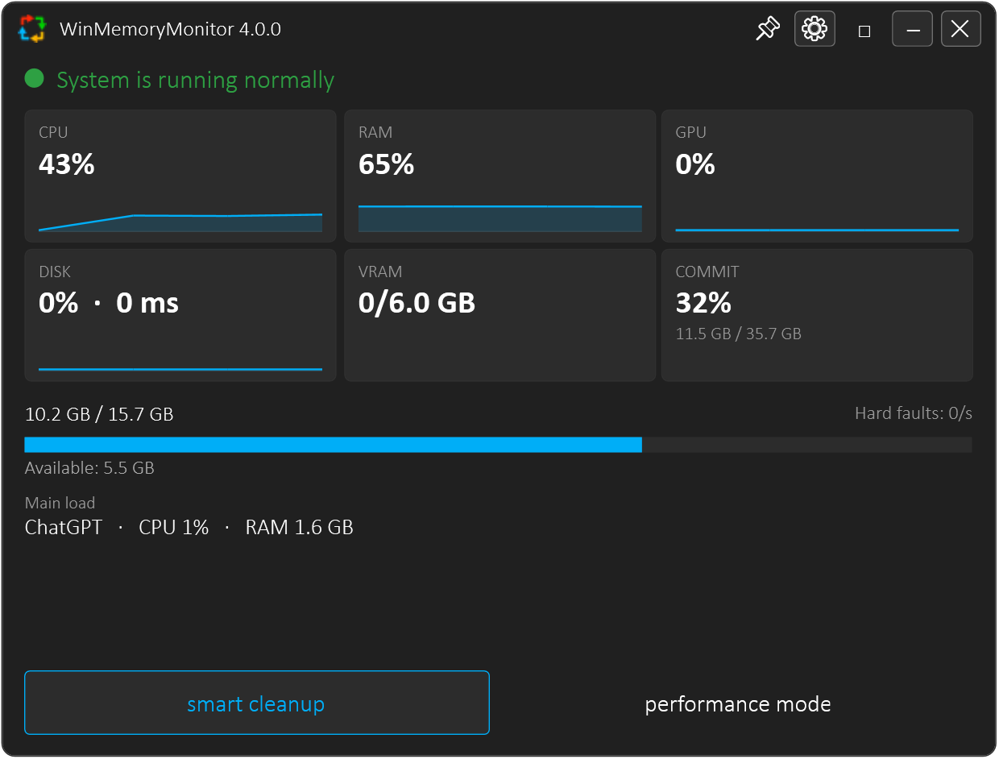
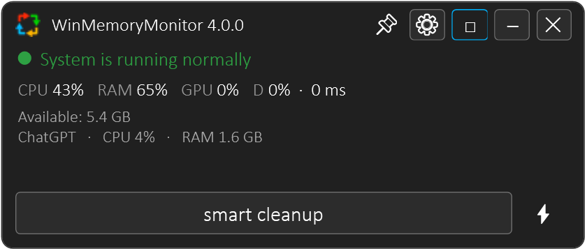
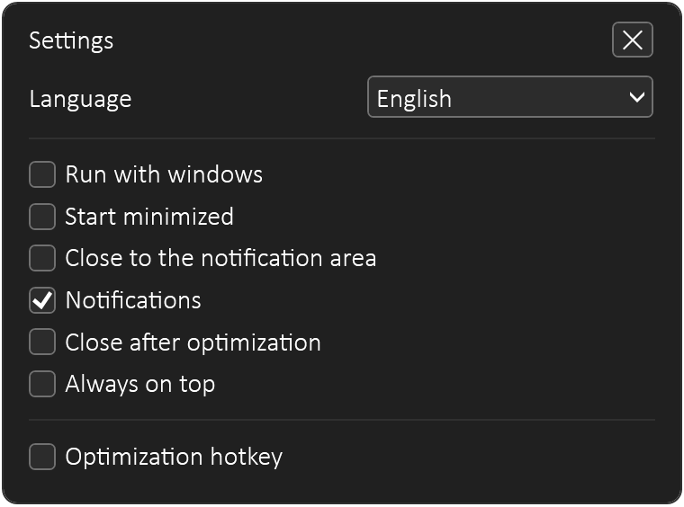

# WinMemoryMonitor

A portable Windows app for watching memory pressure and running a targeted cleanup when RAM is tight. See RAM, commit, CPU, GPU, VRAM, disk activity, hard page faults, and the top memory-consuming process in one window.

**[Download for Windows](https://github.com/ladnoyanehotel/WinMemoryMonitor/releases)**



## What it does

- **Live dashboard.** See current resource use and recent trends at a glance.
- **Smart cleanup.** Check memory pressure before cleaning. The cleanup runs in a separate worker with a 12-second timeout.
- **Compact mode and system tray.** Keep essential metrics visible in a small window or leave the app running in the background.
- **Configurable controls.** Set a global hotkey or use performance mode to switch the Windows power plan.

| Compact mode | Settings |
| --- | --- |
|  |  |

## Install and update

1. Download `WinMemoryMonitor-4.0.0.zip` from [GitHub Releases](https://github.com/ladnoyanehotel/WinMemoryMonitor/releases).
2. Extract the whole archive to a folder and keep `WinMemoryCleaner.exe` and `WinMemoryCleaner.Worker.exe` together.
3. Run `WinMemoryCleaner.exe`. The release requests administrator privileges for Windows memory operations.

The ZIP is portable and the executables are unsigned. To update, close the app, extract the new release, and replace both executables together. Automatic software updates are disabled. The app can still trigger memory cleanup after sustained critical memory pressure.

The release was built on Windows 11 and targets .NET Framework 4.0. GPU and VRAM readings depend on Windows performance counters and may be unavailable on some systems.

## Build from source

On Windows with NuGet CLI and MSBuild installed, run these commands from the repository root in PowerShell.

```powershell
nuget restore src/WinMemoryCleaner.sln -ConfigFile src/nuget.config
$refs = (Resolve-Path src/packages/Microsoft.NETFramework.ReferenceAssemblies.net40.1.0.3/build).Path
$framework = (Resolve-Path "$refs/.NETFramework/v4.0").Path
msbuild src/WinMemoryCleaner.sln /t:Build /p:Configuration=Release /p:CI=true "/p:TargetFrameworkRootPath=$refs" "/p:FrameworkPathOverride=$framework"
```

The two executables are written to `src/bin/Release/`.

## Credits and license

WinMemoryMonitor is based on [Windows Memory Cleaner 3.0.8.0](https://github.com/IgorMundstein/WinMemoryCleaner) by Igor Mundstein and its contributors. This version adds the dashboard, memory-pressure checks, the isolated cleanup worker, and a redesigned compact view and settings window.

Distributed under the [GNU General Public License v3.0](LICENSE).
